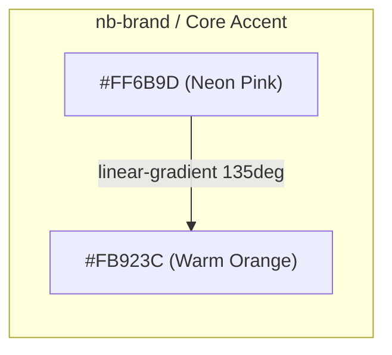

# Devora Design System & Scope Specification
> **Architecture, Theming, Motion Physics, and Neo-Brutalist Component Law**

---

## 1. Executive Summary & Design Philosophy

Devora’s design identity is built upon **Neo-Brutalist Tactile Realism** (internally designated as **Design Law**). It rejects standard corporate SaaS minimalism (muted grays, soft 20px blur shadows, and delicate 1px borders) in favor of **bold ink lines, hard offset drop shadows, paper textures, perforated ticket stubs, and physics-driven micro-interactions**.

### Core Tenets
1. **High-Contrast Ink Chrome**: Heavy 2.5px to 3px solid ink borders (`#0A0A0A` in Light Mode, `rgba(255,255,255,0.35)` or `#FFFFFF` in Dark Mode).
2. **Zero-Blur Hard Shadows**: Shadows are opaque, directional offsets (`[3.5px_3.5px_0px_#0A0A0A]`, `[5px_5px_0px_#0A0A0A]`), never fuzzy gaussian blurs.
3. **Tactile Mechanical Feedback**: Buttons sink into their drop shadows when pressed (`active:translate-x-0.5 active:translate-y-0.5 active:shadow-[1px_1px_0px_#0A0A0A]`) mimicking physical arcade buttons.
4. **Selective Secondary Radiance**: Bold color gradients are reserved strictly for badges, pills, category bands, active tabs, and avatars. Cards and page backgrounds remain crisp paper/slate surfaces.
5. **Physical Metaphors**: Tickets feature perforated dashed borders, circular punch notches, tear-off stubs, and vinyl stickers with angled rotations.

---

## 2. Color Palette & Token Hierarchy

Devora utilizes a semantic token system namespaced under `nb` (Neo-Brutalist) with unified support for Light and Dark themes.

### 2.1 Monochromatic Chrome

| Token | Light Theme | Dark Theme | Purpose |
| :--- | :--- | :--- | :--- |
| `--nb-ink` | `#0A0A0A` | `#FBF6F8` | Primary text, heavy borders, button foregrounds |
| `--nb-paper` | `#F2F2F0` | `#08040F` | Page background, card sub-panels, perforated stubs |
| `--nb-white` | `#FFFFFF` | `#120C1E` | Primary card faces, modal dialogs, elevated blocks |
| `--nb-soft` | `#E3E3DF` | `#190F26` | Secondary chip backgrounds, table headers, hover tints |
| `--nb-muted` | `#575757` | `#B3A7BE` | Secondary descriptions, timestamps, subheadings |
| `--nb-border` | `#0A0A0A` | `rgba(255,255,255,0.35)` | Structural outlines (`3px` for cards, `2.5px` for buttons) |
| `--nb-shadow` | `#0A0A0A` | `#000000` | Hard offset drop shadows (zero blur radius) |

---

### 2.2 Devora Signature Brand & Category Gradients

> [!IMPORTANT]
> **Text on Brand Rule**: Text layered over any radiant brand or category gradient is **always deep ink (`#0A0A0A`)** for guaranteed AAA contrast and visual punch.



| Gradient Name | CSS Definition | Hex Stops | Usage Scope |
| :--- | :--- | :--- | :--- |
| `nb-brand` | `linear-gradient(135deg, #FF6B9D 0%, #FB923C 100%)` | `#FF6B9D` → `#FB923C` | Primary CTAs, active filters, ticket headers, brand badges |
| `nb-accent` | `linear-gradient(90deg, #6206F1 0%, #9911E1 20%, #BF25B9 40%, #EB2D85 60%, #FA3467 80%, #FF6A1F 100%)` | Full spectrum ramp | Hero title kinetic text, landing banners, premium badges |
| `nb-sky` | `linear-gradient(135deg, #7DD3FC 0%, #A78BFA 100%)` | `#7DD3FC` → `#A78BFA` | Academic events & clubs, study sessions |
| `nb-orchid` | `linear-gradient(135deg, #A78BFA 0%, #E879F9 100%)` | `#A78BFA` → `#E879F9` | Competitive events, hackathons, formula racing |
| `nb-blush` | `linear-gradient(135deg, #FDA4AF 0%, #FB7185 100%)` | `#FDA4AF` → `#FB7185` | Social events, casual meetups, hangouts |
| `nb-emerald` | `linear-gradient(135deg, #34D399 0%, #10B981 100%)` | `#34D399` → `#10B981` | "My Week" saved filters, success states, verified tags |

---

## 3. Typography Scale & Fonts

Devora establishes clear hierarchy through distinct typographic personalities:

```
┌─────────────────────────────────────────────────────────────┐
│ DISPLAY (Archivo Black)  : POSTERS, TICKET HEADS, HEROES   │
│ MONOSPACE (JetBrains)    : DATES, TAGS, BADGES, META, CODE │
│ BODY (Inter / System UI) : PARAGRAPHS, DESCRIPTIONS, BIOS  │
└─────────────────────────────────────────────────────────────┘
```

1. **Display Typography (`font-display` / `font-nb-display`)**:
   - **Font**: `Archivo Black`, `Arial Black`, sans-serif.
   - **Weight**: 900 / Black.
   - **Tracking**: Tight (`tracking-[-0.03em]`).
   - **Line Height**: Compact (`leading-[0.85]` to `leading-none`).
   - **Application**: Organization initials (`ACM`, `GDSC`), event dates, section titles.

2. **Technical Monospace (`font-mono` / `font-nb-mono`)**:
   - **Font**: `JetBrains Mono`, `ui-monospace`, monospace.
   - **Tracking**: Wide (`tracking-[0.08em]` to `tracking-[0.16em]`).
   - **Casing**: Uppercase.
   - **Application**: Category tags, date headers (`NOV 24`), button labels (`VIEW OFFICIAL PAGE`), live counts (`142 MEMBERS`).

3. **Readable Body (`font-body` / `font-nb-body`)**:
   - **Font**: `Inter`, `system-ui`, sans-serif.
   - **Weight**: 400 (Regular), 600 (Semibold), 800 (Extrabold).
   - **Application**: Descriptions, multi-line bios, form inputs, meeting notes. Ensures zero eye fatigue.

---

## 4. GSAP Animation Engine & Physics

Devora relies on **GreenSock (GSAP 3)** and `@gsap/react` for natural, tactile interactions.

### 4.1 Button Switch & Toggle Physics (Elastic Bounce)
When toggling a binary state (Following a club, saving an event, joining a study group), the button compresses and bounces back with an elastic recoil:

```typescript
// Button State Switch Animation (Follow, Bookmark, Join)
if (buttonRef.current && !window.matchMedia("(prefers-reduced-motion: reduce)").matches) {
  gsap.fromTo(
    buttonRef.current,
    { scale: 0.85 },
    { 
      scale: 1, 
      duration: 0.45, 
      ease: "elastic.out(1.2, 0.4)",
      clearProps: "transform" 
    }
  );
}
```

### 4.2 Interactive Sticker Rotation (Physics Hover)
Ticket badges and "Most Followed" / "Featured" stickers tilt dynamically when hovered:

```typescript
// Pointer Enter: Tilts left and enlarges slightly
gsap.to(stickerRef.current, {
  rotate: -6,
  scale: 1.08,
  duration: 0.5,
  ease: "elastic.out(1.2, 0.4)"
});

// Pointer Leave: Returns to resting canted angle
gsap.to(stickerRef.current, {
  rotate: 4,
  scale: 1,
  duration: 0.5,
  ease: "elastic.out(1.2, 0.4)"
});
```

### 4.3 Route Tracking Sliding Tab Pill (`TabNav.tsx`)
The active tab pill smoothly glides across the navigation bar using an overshoot spring (`back.out(1.7)`):

```typescript
// Smooth navigation indicator glide
gsap.to(pillRef.current, {
  x: targetX,
  width: targetWidth,
  duration: 0.55,
  ease: "back.out(1.7)",
});
```

### 4.4 Modal Entrances & Exits (`PostEventModal.tsx`, `CreateGroupModal.tsx`)
- **Entrance**: Backdrop blurs (`backdrop-blur-[5px]`) while the modal dialog scales up from `0.95` and rises `18px` with `power2.out`.
- **Exit**: High-speed dismissal with `power2.in` before state unmounts:
```typescript
gsap.to(modalRef.current, {
  y: 16,
  scale: 0.96,
  autoAlpha: 0,
  duration: 0.15,
  ease: "power2.in",
  onComplete: () => closeModal()
});
```

### 4.5 Cascading List Stagger (`nb-rise`)
Lists of cards stagger into view with a 55ms delay per child up to an 8-item ceiling:
```typescript
export function staggerStyle(index: number): CSSProperties {
  return { animationDelay: `${Math.min(index, 8) * 55}ms` };
}
```

---

## 5. UI Component Specifications

### 5.1 Event Tickets (`EventTicket.tsx`)
Three-part perforated ticket structure:
1. **Left Date Block (`105px`)**: Solid category tint, calendar month (`font-mono text-xs font-black`), giant day (`font-display text-[44px]`), day-of-week (`font-mono text-[11px]`).
2. **Center Event Body (`minmax(0, 1fr)`)**: Title, 2-line description, location icon badge, time icon badge, host organization, external links.
3. **Right Perforated Stub (`240px`)**:
   - Dashed perforated left border with top and bottom semicircle ticket punch notches.
   - Tag chips (`Tag.tsx`) with 2px borders.
   - Full-width `Save to my week` action button with high-contrast text and 3px offset shadow.

```
┌─────────┬────────────────────────────────────────────┬────────────────────────┐
│   NOV   │ Formula Electric Shop Night                │  [WORKSHOP]  [CLUB]    │
│   24    │ Hands-on chassis fabrication & telemetry.  │                        │
│   TUE   │ (D) 6:00 PM  (L) ELB 1030  (O) Racing Team │  [+ Save to my week]   │
└─────────┴────────────────────────────────────────────┴────────────────────────┘
  Date Blk                  Body                       Perforated Stub (240px)
```

---

### 5.2 Club Organization Cards (`ClubCard.tsx`)
1. **Header Ticket Band**:
   - Category tag pill (`ACADEMIC`, `PROFESSIONAL`, etc.) + optional tilted badge (`★ Featured`).
   - Official Organization Logo Badge (`64x64px`, white card, 2.5px ink border, 3px shadow) with fallback initials monogram.
   - Short Name in Archivo Black (`42px` to `72px`).
2. **Card Body**:
   - Full organization name, description clamped to 3 lines, meeting cadence.
   - Bottom links row: `Open feed` link + tactile `View Official Page` external button (`target="_blank"`).
3. **Bottom Stub**:
   - Perforated top border with circular punch cutouts.
   - Member count, Follower count.
   - Tactile `Follow` / `Following` button with elastic scale animation.

---

### 5.3 Event & Group Maker Modals (`PostEventModal.tsx`, `CreateGroupModal.tsx`)
- **Dimensions**: Wide landscape format (`w-[94vw] max-w-[880px]`).
- **Vertical Constraint**: Natural height is compact (`~410px`), ensuring it **never cuts off** on laptop screens or viewports with browser toolbars open.
- **Two-Column Layout**:
  - **Left Column**: Event Title (`h-9`), 2-line Description (`h-[58px]`), Optional Link (`h-9`).
  - **Right Column**: Side-by-side Date & Time (`h-9`), Location (`h-9`) with Quick Preset chips (`+ Library`, `+ ELB Room`), and Tag selector pills.
- **Pinned Bottom Actions**: Cancel button + Vibrant brand `Post Event` button with offset shadow.

---

### 5.4 Celestial Theme Switcher (`DarkLightButton.tsx`)
- Day/Night physical track with animated clouds, 4 twinkling stars, and an embossed sun/moon orb.
- Sun orb features rotating solar corona rays.
- Moon orb features detailed crater indents.

---

## 6. Accessibility & Motion Compliance

Devora enforces strict compliance with the **WCAG 2.1 AA** standard:
- **`prefers-reduced-motion`**: All GSAP tweens, kinetic split-text masks, and CSS keyframe animations automatically disable when the user has reduced motion enabled in their OS.
- **Keyboard Navigation**: Buttons and interactive cards feature high-visibility 3px focus rings with a 2px offset (`focus-visible:outline focus-visible:outline-[3px] focus-visible:outline-offset-2 focus-visible:outline-[#FF6B9D]`).
- **Screen Readers**: Visual stickers, ticket punch notch decorations, and kinetic text wrappers include `aria-hidden="true"`, with plain semantic text provided via `.sr-only`.
