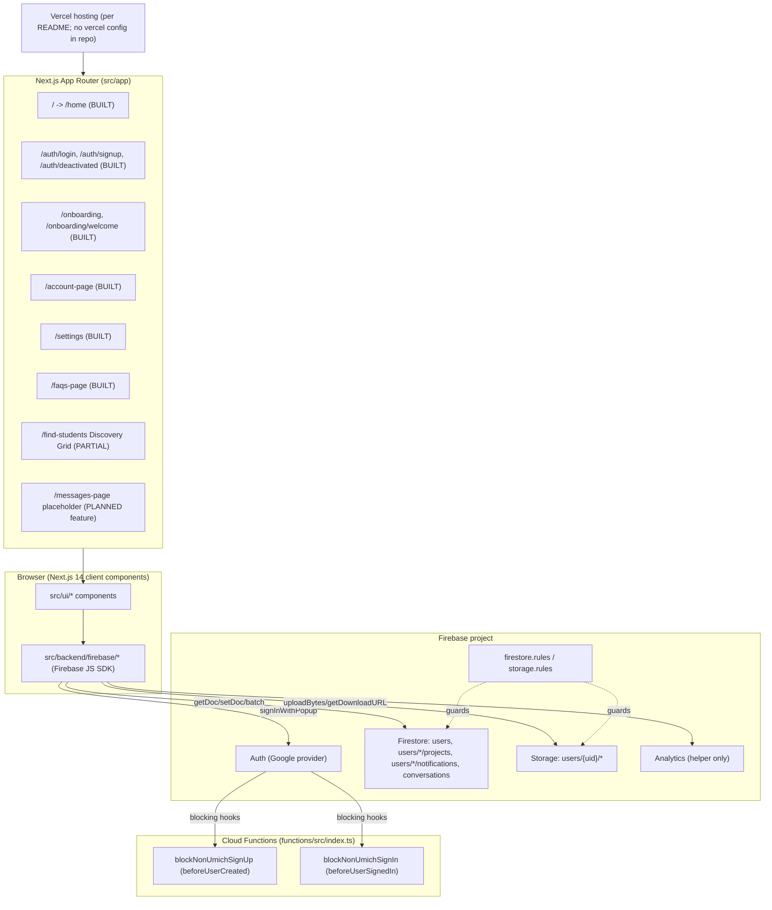

# Software Design Specification — Devora

**Format:** IEEE 1016-style SDS. No template existed at `docs/SDS.md` when this was written, so the section layout follows the structure requested for this task (1 Introduction, 2 Data design, 3 Architecture and components, 4 Interface, 5 Constraints, 6 Testing, 7 Traceability, Appendix A).

**Basis:** Written from the repository source only. Every claim cites a path. Paths are relative to the repo root; the Next.js app lives in `devora/`, so `devora/src/...` is the app source.

**Status labels**

| Label | Meaning |
|-------|---------|
| BUILT | Implemented in code and wired into a route or deployed config. |
| PARTIAL | Code exists but is not wired in, or only part of the feature exists. |
| PLANNED | Appears only in docs or marketing copy, or nowhere in code. |

> **Corrections to the starting assumptions** (verified against code):
> 1. **Discovery Grid cards are not rendered at all, not even with mock data.** `DiscoveryGridContent.tsx` mounts only the Filters toolbar and drawer. Nothing imports `DiscoveryProfileCard`, `DiscoveryProfilePeek` or `MOCK_PROFILES` (grep of `devora/src` finds imports only inside `cards/*` and `mock-profiles.ts` itself). The cards are unmounted, mock-only components. See 3.2.4.
> 2. **The `@umich.edu` gate is not the same in all three places.** Cloud Functions accept only `@umich.edu`; the client and Firestore rules also accept `@umd.umich.edu`. See 2.1.4 and 3.2.1.
> 3. **`/find-students` has no sign-in redirect in code**, although `devora/src/docs/DESIGN_SCOPE.md:484` lists it as protected. See 3.2.4.

---

## 1. Introduction

### 1.1 Purpose
Devora is a social-connection web app for College of Engineering and Computer Science (CECS) students at UM-Dearborn (`README.md:5`). This document describes the design as implemented today and marks what is not built.

### 1.2 Scope and feature status

| Feature | Status | Evidence |
|---------|--------|----------|
| Landing page (`/home`, `/` redirects to it) | BUILT | `devora/src/app/page.tsx`, `devora/src/app/home/page.tsx`, `devora/src/ui/home/` |
| Google sign-in, client-side `@umich.edu` / `@umd.umich.edu` check | BUILT | `devora/src/backend/firebase/auth.ts`, `devora/src/ui/auth/sign-in-actions.ts` |
| Server-side sign-up and sign-in blocking (Cloud Functions) | BUILT in source; deployment not verifiable | `devora/functions/src/index.ts` |
| Firestore rules `@umich.edu` gate | BUILT in source; deployment not verifiable | `devora/firestore.rules:5-15` |
| Signup, login, deactivated screens | BUILT | `devora/src/app/auth/*`, `devora/src/ui/auth/*` |
| 5-step onboarding and welcome screen | BUILT | `devora/src/ui/account/onboarding/OnboardingForm.tsx`, `WelcomeScreen.tsx` |
| Account page (view and editor) | BUILT | `devora/src/ui/account/AccountPageContent.tsx`, `editor/AccountProfileEditor.tsx`, `profile/*` |
| Settings (privacy and notification toggles, deactivate, delete) | BUILT | `devora/src/ui/settings/page/SettingsPageContent.tsx`, `devora/src/backend/firebase/account-lifecycle.ts` |
| FAQs page | BUILT | `devora/src/app/faqs-page/page.tsx`, `devora/src/ui/faqs/FAQAccordion.tsx` |
| Discovery Grid filter panel (search box, 8 pill sections, clear) | BUILT (local state only) | `devora/src/ui/discovery/DiscoveryGridContent.tsx`, `filters/DiscoveryFilterSidebar.tsx`, `filter-options.ts` |
| Discovery Grid cards, profile peek, social icons | PARTIAL: components exist, typed to `DiscoveryProfile` from mock data, mounted nowhere | `devora/src/ui/discovery/cards/*`, `mock-profiles.ts` |
| `profileMatchesFilters` filtering | PARTIAL: implemented but called nowhere | `devora/src/ui/discovery/mock-profiles.ts:246` |
| Discovery browse query from Firestore | PLANNED | `devora/src/docs/discovery-grid.md` ("Why the grid is off") |
| Connect button, connections | PLANNED | `devora/src/docs/discovery-grid.md` (Peek, Firebase TODO); no code |
| Study groups | PLANNED: marketing copy only | `devora/src/ui/home/sections/BestUseCases.tsx:56` |
| Real-time messaging | PLANNED: `/messages-page` is a "coming soon" placeholder | `devora/src/app/messages-page/page.tsx` |
| Events | PLANNED | marketing copy only: `devora/src/ui/home/sections/FeatureCards.tsx:40`, `README.md:188` ("Shell (Week 7)") |
| HelloRubric integration | PLANNED: no mention in code or docs (README mentions "VictorsLink → Rubric API" in the outreach section) | not in source |
| Electron Mac app | PLANNED: no mention in code or docs (`devora/src/docs/mobile-app-roadmap.md` plans PWA/Capacitor iOS, not Electron) | not in source |
| Project portfolio (`users/{uid}/projects`) | PARTIAL: rules and delete-cleanup exist; no create/read UI found | `devora/firestore.rules`, `account-lifecycle.ts:25` |
| Notifications (`users/{uid}/notifications`) | PARTIAL: same as projects | same |
| Firebase Analytics | BUILT (helper only; no caller found) | `devora/src/backend/firebase/usage-tracking.ts` |

### 1.3 References
`devora/src/docs/firestore-schema.md`, `devora/src/docs/discovery-grid.md`, `devora/src/docs/DESIGN_SCOPE.md`, `README.md`, `docs/check-in-1.md`.

---

## 2. Data Design

Datastore: Cloud Firestore (database), Firebase Storage (files), Firebase Auth (identity). Client init is in `devora/src/backend/firebase/start-firebase.ts`; config comes from `NEXT_PUBLIC_FIREBASE_*` variables (`env-keys.ts`, `devora/.env.example`).

### 2.1 `users` collection (BUILT)

Document ID is the Firebase Auth UID (`devora/src/docs/firestore-schema.md`, "Full `users/{uid}` document"; `user-profile.ts` uses `doc(db, "users", uid)`).

#### 2.1.1 Fields per `firestore-schema.md`, checked against `user-profile.ts`

Types from `devora/src/backend/firebase/user-profile.ts:75-101` (`UserProfile`). "Written by" is the function that sets the field.

| Field | Type | Written by | Notes |
|-------|------|-----------|-------|
| `email` | string | `saveSignupProfile`, `saveOnboardingProfile` | Private per schema |
| `firstName`, `lastName`, `displayName` | string | `saveSignupProfile` (`displayName` = `"first last"`) | |
| `school` | string | both save functions | Hard-coded `"University of Michigan-Dearborn"` |
| `isPublic` | boolean | signup `false`; onboarding `true`; Settings toggle; deactivate `false`; reactivate `true` | |
| `onboardingComplete` | boolean | signup `false`; onboarding `true` | |
| `createdAt`, `updatedAt` | Timestamp | `serverTimestamp()`; onboarding keeps an existing `createdAt` | |
| `classRank`, `gender`, `age` | string | onboarding step 1; editor | |
| `major` | string | onboarding step 2; editor | |
| `careerNiche` | string[] | step 2; editor | |
| `careerNicheOther` | string | step 2 (stored `""` if empty) | |
| `hasExperience` | boolean | step 2 | |
| `experienceDetails` | string | step 2 (`""` if No) | |
| `casualInterests` | string[] | step 3 (pills merged with custom text via `mergeCasualInterests`) | |
| `aboutYou` | string[] | step 3 | |
| `religion` | string, optional | step 3 | See 2.1.3 |
| `signupReason` | string[] | step 4 | |
| `bio` | string | step 5 (20-150 chars enforced in `OnboardingForm.tsx` `canContinue`) | |
| `photoURL` | string | step 5 upload, editor (stored `""` if no photo) | |
| `links.github` / `links.linkedin` / `links.instagram` | string | step 5 (stored as trimmed strings, possibly `""`) | |
| `isDeactivated`, `deactivatedAt` | boolean, Timestamp or null | `account-lifecycle.ts` | |
| `preferences` | `UserPreferences` (11 keys) | `updateUserSettings` | Not in the schema doc, see 2.1.2 |

Query and filter claims in `firestore-schema.md` ("Query patterns", "Filter alignment") are a design, not code. No `users` browse query exists in `devora/src` (PLANNED).

#### 2.1.2 Discrepancies (schema doc vs code vs rules)

| # | Discrepancy | Sources |
|---|-------------|---------|
| D1 | `preferences` (11 settings keys such as `notifyMessages`, `allowMessagesFrom`, `showReadReceipts`) is in `UserProfile` and written by Settings but is absent from `firestore-schema.md`. | `user-profile.ts:21-33, 98`; `firestore-schema.md` |
| D2 | `lastActiveAt` is in the schema document but not in `UserProfile` and not written anywhere in `devora/src`. | `firestore-schema.md`; grep of `devora/src` |
| D3 | Schema says optional `religion` is "omitted"/optional, and `OnboardingForm.tsx` comments say it is "omitted from Firestore" when blank. In fact `saveOnboardingProfile` writes `religion: data.religion ?? ""`, so an empty string is stored. Same pattern for `careerNicheOther`, `experienceDetails`, `photoURL`. | `user-profile.ts:~262-272`; `OnboardingForm.tsx:79, 258` |
| D4 | Schema marks many onboarding fields "required"; in `UserProfile` they are all optional (`?`), since the document exists from signup before onboarding. Required-ness is enforced only in the UI (`canContinue`), not in types or rules. | `user-profile.ts:77-96`; `OnboardingForm.tsx:canContinue` |
| D5 | Schema says private fields (`email`, `religion`, `signupReason`) are never on cards and "not in browse queries". Firestore rules let any `@umich.edu` / `@umd.umich.edu` signed-in user read the entire `users/{userId}` document regardless of `isPublic`, `isDeactivated`, or field. Privacy tiers are therefore enforced only by client code (and there is no browse client yet). | `firestore.rules:25-26`; `firestore-schema.md` "Privacy tiers" |
| D6 | Schema says `isPublic: false` excludes a user from browse. No rule or query enforces that (see D5). | `firestore.rules`; `firestore-schema.md` |
| D7 | Email domain: schema and Cloud Functions say `@umich.edu` only. Rules and client also accept `@umd.umich.edu`. The Functions check is `endsWith("@umich.edu")`, which does not match `x@umd.umich.edu`. A Dearborn address that passes client and rules would be rejected by the blocking functions (if deployed). | `functions/src/index.ts:3-13`; `firestore.rules:5-10`; `auth.ts:24-32`; `firestore-schema.md` line 5 |
| D8 | Rules compare email with case-sensitive regex (`.*@umich\\.edu$`). Client and Functions lowercase before comparing. A mixed-case token email would pass client/Functions but could fail rules. | `firestore.rules:5-10`; `auth.ts:30-34`; `functions/src/index.ts:6` |
| D9 | Filter UI has sections (CIS/CIA Concentration, Media & Entertainment, Clubs & Orgs) that the schema marks "future" and that have no `users` field. Hobbies and Media both match against `casualInterests`. | `filter-options.ts:153-215`; `firestore-schema.md` "Filter alignment"; `mock-profiles.ts:285-293` |
| D10 | `discovery-grid.md` says search covers name, major, concentration, niches, interests, looking-for, clubs. `profileMatchesFilters` actually searches name, major, `majorShort`, bio, niches, interests, clubs (not concentration or looking-for). | `discovery-grid.md` "Filters"; `mock-profiles.ts:255-266` |
| D11 | Schema says Account hides `religion`, `signupReason`. Verified: neither appears in `devora/src/ui/account/profile/*` or `editor/*`; `AccountProfileUpdate` does not include `religion`, so it cannot be edited after onboarding. | `user-profile.ts:~140-158` |
| D12 | Schema "Redirect flow" omits that Finish in onboarding goes to `/onboarding/welcome` first (`OnboardingForm.tsx`), which then links to `/find-students` (`WelcomeScreen.tsx:83`). Minor. | `firestore-schema.md` "Redirect flow" |
| D13 | Schema footer: "Last updated Aug 31, 2026"; `discovery-grid.md` is Sep 16, 2026. The schema predates `preferences` and the Settings page. | docs |

#### 2.1.3 Religion field handling (per schema)
`religion` is optional (`canContinue` for step 3 always returns true, `OnboardingForm.tsx:~185`). Not shown on cards and not filterable per `firestore-schema.md` ("On card? never; Filterable? never"). Verified in code: `religion` is not among the 8 filter sections (`filter-options.ts`), not in the `DiscoveryProfile` card type (`mock-profiles.ts:11-31`), and not in Account UI. The code does not currently enforce this beyond not rendering it (see D5).

#### 2.1.4 Security rules (BUILT in source)
`devora/firestore.rules`:

| Path | Read | Write |
|------|------|-------|
| `users/{userId}` | umich user, or owner | create/update: owner and `request.resource.data.email` is a umich address; delete: owner and umich user |
| `users/{userId}/notifications/{id}` | umich owner | umich owner |
| `users/{userId}/projects/{id}` | any umich user | umich owner |
| `conversations/{id}` and `/messages/{id}` | umich user in `participantIds` | same |

Note: the `conversations` rules (PLANNED feature) are present but no collection design or client code exists. As written, `resource.data.participantIds` is not evaluable on create, so a first create would be denied; behavior is unverified (no emulator run).

### 2.2 `firestore.indexes.json` (BUILT, empty)
`devora/firestore.indexes.json` contains `"indexes": []` and `"fieldOverrides": []`. `firestore-schema.md` ("Query patterns") says composite indexes will be needed for `isPublic + major`, `isPublic + classRank`, `isPublic + careerNiche`, `isPublic + casualInterests`. None are defined. `discovery-grid.md` says multi-section filtering is client-side because Firestore cannot AND every combination.

### 2.3 `storage.rules` (BUILT)
`devora/storage.rules`: only `match /users/{userId}/{fileName}`. Read: any signed-in user (`request.auth != null`, not restricted to umich). Write: only when `request.auth.uid == userId`. No size or content-type limit. No rule for other paths, so they are denied by default. Upload path is `users/{uid}/avatar.{ext}` (`storage-upload.ts`); the uploader keeps the original file extension, so a user with different extensions over time could leave multiple avatar files (deleteOwnAccount lists and removes the whole folder, `account-lifecycle.ts`).

### 2.4 Connections, study groups, messages (PLANNED)
Not designed. No collection, fields or types exist in `devora/src`. Only `conversations` rules (2.1.4) and a `MessagePolicy` preference type exist (`user-profile.ts:18`). No fields are specified here.

---

## 3. Architecture and Component Design

### 3.1 System architecture

#### 3.1.1 Architecture diagram



Facts behind the diagram:
- Stack: Next 14.2.35, React 18, TypeScript, Tailwind, Firebase JS SDK 12 (`devora/package.json`). `next.config.mjs` is empty.
- There is no server-side data access in the Next app. Route files are thin; data access happens in client components through `src/backend/firebase/*` (for example `AccountPageContent.tsx` is `"use client"`). Server components only issue redirects (`app/page.tsx`, `app/auth/page.tsx`).
- No Next.js `middleware` file exists, so route protection is client-side redirect logic per component (see 3.2.1).
- Cloud Functions: `firebase.json` registers `functions/` (codebase `default`); runtime Node 20 (`functions/package.json`); two blocking triggers only.
- Hosting: README states Vercel; no `vercel.json` or CI config is in the repo. Deployment state: unverified. `docs/check-in-1.md` says the Vercel deployment was "In progress" on Sep 9, 2026.

#### 3.1.2 Alternatives considered
- Auth approach alternatives: [AUTHOR TO COMPLETE]
- Data store alternatives (Firestore vs institutional hosting): [AUTHOR TO COMPLETE]
- Rendering/hosting alternatives (client-side data access vs server routes): [AUTHOR TO COMPLETE]
- Discovery filtering alternatives (client-side vs Firestore queries vs a search service): [AUTHOR TO COMPLETE]
- Rationale for chosen approaches: [AUTHOR TO COMPLETE]

### 3.2 Component-level design

#### 3.2.1 Auth module (BUILT)

Files: `devora/src/backend/firebase/auth.ts`, `auth-errors.ts`, `devora/src/ui/auth/sign-in-actions.ts`, `devora/src/ui/auth/{login,signup,google,layout,deactivated}/*`, `devora/functions/src/index.ts`.

Responsibilities:
- `isUmichEmail(email)`: domain gate (client).
- `signInWithGoogle(schoolEmail?)`: opens a Google popup with `prompt: select_account` and `hd`/`login_hint` hints when the typed email matches a UMich domain; signs out and throws if the resulting account is not a UMich address or differs from the typed email.
- `handleGoogleSignIn(router, mode, options)` (`sign-in-actions.ts`): the shared pipeline for login and signup.
- `signOutUser`, `reauthenticateWithGoogle` (used before account deletion).
- `signUpWithEmail` / `signInWithEmail` exist but are unused by the UI ("reserved for future use", `auth.ts`).
- `getAuthErrorMessage` maps Firebase error codes to UI strings.

**Three layers of the email gate**

| Layer | Allowed | Check | File |
|-------|---------|-------|------|
| Client pre-check and post-popup check | `@umich.edu`, `@umd.umich.edu` | `endsWith` on trimmed lowercase email | `auth.ts:24-32` |
| Cloud Functions `beforeUserCreated` / `beforeUserSignedIn` | `@umich.edu` only | `endsWith("@umich.edu")` on trimmed lowercase email | `functions/src/index.ts` |
| Firestore rules on `users` | both domains | regex, case-sensitive | `firestore.rules:5-10` |

Pseudocode, umich email gate (client, `auth.ts`):

```
ALLOWED = ["@umich.edu", "@umd.umich.edu"]
isUmichEmail(email):
    n = lowercase(trim(email))
    return any(n.endsWith(d) for d in ALLOWED)

signInWithGoogle(schoolEmail):
    provider = Google provider with prompt=select_account
    if schoolEmail recognized: set hd and login_hint
    result = popup sign-in
    if not isUmichEmail(result.user.email or ""):
        signOut(); throw UMICH_ONLY_ERROR
    if schoolEmail given and result email != schoolEmail (case-insensitive):
        signOut(); throw "Use the same Michigan Google account..."
    return result
```

Pseudocode, server gate (`functions/src/index.ts`):

```
assertUmichEmail(email):
    n = lowercase(trim(email or ""))
    if not n.endsWith("@umich.edu"):
        throw HttpsError("permission-denied", ...)
blockNonUmichSignUp  = beforeUserCreated(event -> assertUmichEmail(event.data.email))
blockNonUmichSignIn  = beforeUserSignedIn(event -> assertUmichEmail(event.data.email))
```

Pseudocode, post-sign-in routing (`sign-in-actions.ts`):

```
handleGoogleSignIn(mode, firstName, lastName, schoolEmail):
    if not isUmichEmail(schoolEmail): throw
    if mode == signup and (no firstName or no lastName): throw
    result = signInWithGoogle(schoolEmail)
    force-refresh ID token
    profile = getUserProfile(uid)
    if mode == signup and names given: saveSignupProfile(...); reload profile
    else if profile is null: derive names from Google displayName; saveSignupProfile(...); reload
    if not profile.onboardingComplete: go /onboarding
    else if profile.isDeactivated:     go /auth/deactivated
    else:                              go /find-students
```

Route protection: each protected component runs `onAuthStateChanged` and redirects to `/auth/login` when signed out (onboarding, welcome, account, settings, deactivated: `OnboardingForm.tsx`, `WelcomeScreen.tsx`, `AccountPageContent.tsx`, `SettingsPageContent.tsx`, `DeactivatedAccountScreen.tsx`). `/find-students` and `/messages-page` contain no such check.

#### 3.2.2 Onboarding module (BUILT)

Files: `devora/src/app/onboarding/page.tsx`, `devora/src/ui/account/onboarding/{OnboardingForm,WelcomeScreen}.tsx`, `onboarding-options.ts` (`ONBOARDING_STEPS = 5`, `STEP_TITLES`), `devora/src/ui/shared/pills/PillGroup.tsx`.

Behavior:
- Auth gate: signed out goes to `/auth/login`; already `onboardingComplete` goes to `/find-students`.
- Wizard state is local React state; one Firestore write happens on Finish.
- Finish: optional photo upload (`uploadProfilePhoto`), then `saveOnboardingProfile`, then navigate to `/onboarding/welcome`.
- `saveOnboardingProfile` preserves names and `createdAt` from an existing doc, sets `isPublic: true` and `onboardingComplete: true`.

Step validation (`canContinue`, `OnboardingForm.tsx`):

```
case 1: classRank and gender and age all chosen
case 2: major chosen, >=1 careerNiche, hasExperience answered,
        and (hasExperience == false or experienceDetails non-empty)
case 3: always true (interests, aboutYou, religion optional)
case 4: >=1 signupReason
case 5: 20 <= len(trim(bio)) <= 150
```

Changing `major` drops any `careerNiche` not valid for the new major (`handleMajorChange`).

Notes: Photo upload happens before the profile write; if the profile write fails after a successful upload, the file remains (observed from ordering; not tested).

#### 3.2.3 Account module (BUILT)

Files: `devora/src/app/account-page/page.tsx`, `devora/src/ui/account/AccountPageContent.tsx`, `editor/AccountProfileEditor.tsx`, `profile/{AccountProfileView,AccountDiscoveryPreview,AccountInfoCard,account-helpers}.tsx`.

- `AccountPageContent` owns state: auth gate (signed out to `/auth/login`; not onboarded to `/onboarding`), load profile, view/edit toggle, save, sign out.
- Save path: optional `uploadProfilePhoto`, then `updateAccountProfile(uid, patch)` (partial `setDoc(..., {merge:true})`; type `AccountProfileUpdate` limits editable fields to bio, major, classRank, gender, age, careerNiche, careerNicheOther, hasExperience, experienceDetails, casualInterests, aboutYou, photoURL, links).
- Helpers: initials, join date, link label, `truncateBio(bio, max=80)` (matches the card snippet length in the schema), interest splitting.
- A "Profile strength" meter value is computed in `account-helpers.ts` (~line 114) for `AccountProfileView`; its algorithm was not read.

Settings (BUILT; adjacent): `SettingsPageContent.tsx` saves `isPublic` and `preferences` on every toggle via `updateUserSettings`, forces `isPublic: false` while deactivated, and hosts deactivate / reactivate / delete.

Account lifecycle (`account-lifecycle.ts`):

```
deactivateAccount(uid): merge {isDeactivated:true, isPublic:false, deactivatedAt:now}
reactivateAccount(uid): merge {isDeactivated:false, isPublic:true, deactivatedAt:null}
deleteOwnAccount():
    require signed-in user; reauthenticateWithGoogle(); verify same uid
    delete all files under Storage users/{uid}   (errors swallowed)
    for name in [projects, notifications]: batch-delete users/{uid}/{name}
    delete users/{uid}; deleteUser(auth user)
```

Observation: `reactivateAccount` sets `isPublic: true` unconditionally, overriding a prior user choice of `isPublic: false`.

#### 3.2.4 Discovery filter module (BUILT filters; PARTIAL grid)

Files: `devora/src/app/find-students/page.tsx`, `devora/src/ui/discovery/DiscoveryGridContent.tsx`, `filters/DiscoveryFilterSidebar.tsx`, `filter-options.ts`; unmounted: `cards/*`, `mock-profiles.ts`.

BUILT:
- `DiscoveryGridContent` holds `query`, `selected` (`Record<FilterSectionId, string[]>`) and `filtersOpen`; toolbar button shows an active-filter badge; drawer is portaled to `document.body`; Escape and backdrop click close it; `clearFilters` resets all.
- `DiscoveryFilterSidebar`: search input and 8 sections from `FILTER_SECTIONS` (majors, concentrations, niches, hobbies, media, clubs, lookingFor, classYear); pills toggle via `aria-pressed`; "Clear N filters" appears when `countActiveFilters > 0`.
- The selection state is held but consumed by nothing: no list is filtered on screen. A user changing filters sees no change in results because there are no results rendered.

PARTIAL (not mounted):
- `DiscoveryProfileCard`, `DiscoveryProfilePeek`, `DiscoveryAvatar`, `DiscoverySocialIcons` render a `DiscoveryProfile` (type defined in `mock-profiles.ts`), not `UserProfile`.
- `mock-profiles.ts` holds `MOCK_PROFILES` and Dicebear avatar URLs. Its own header says it is reference data and not mounted on `/find-students`; `DiscoveryGridContent.tsx` and `discovery-grid.md` say not to use it as live data. It is not live data.
- `DiscoveryProfile` has fields (`clubs`, `lookingFor`, `concentration`, `majorShort`, `accent`) with no counterpart in the Firestore schema except `lookingFor` ~ `aboutYou`.

Pseudocode, `profileMatchesFilters` (`mock-profiles.ts:246`; implemented, currently unused):

```
profileMatchesFilters(profile, query, selected):
    needle = lowercase(trim(query))
    if needle != "":
        haystack = lowercase(join(" ", displayName, major, majorShort, bio,
                                  careerNiche..., casualInterests..., clubs...))
        if needle not in haystack: return false
    if selected.majors nonempty        and profile.major not in selected.majors:          return false
    if selected.concentrations nonempty and (profile.concentration missing
                                             or not in selected.concentrations):          return false
    if selected.niches nonempty        and none of selected.niches in profile.careerNiche:   return false
    if selected.hobbies nonempty       and none of selected.hobbies in profile.casualInterests: return false
    if selected.media nonempty         and none of selected.media in profile.casualInterests:   return false
    if selected.clubs nonempty         and none of selected.clubs in profile.clubs:          return false
    if selected.lookingFor nonempty    and none of selected.lookingFor in profile.lookingFor:   return false
    if selected.classYear nonempty     and profile.classRank not in selected.classYear:      return false
    return true
```

Semantics: AND across sections; OR within the multi-valued sections. For `majors` and `classYear` the check is "profile value is one of the selected values", also an OR. Search is substring-based, case-insensitive.

States required by `discovery-grid.md` (loading, error, empty, no matches, results): none implemented. There is no loading, error, or empty rendering in `DiscoveryGridContent.tsx`; the page shows only the toolbar. `discovery-grid.md` defines the intended conditional tree (PLANNED).

#### 3.2.5 Backend / firebase module (BUILT)

Directory `devora/src/backend/firebase/`; public import path `devora/src/backend/index.ts` re-exports from `firebase/index.ts`. Note `OnboardingForm.tsx` and `AccountPageContent.tsx` import `uploadProfilePhoto` directly from `firebase/storage-upload`, bypassing the index (the index also exports it).

| File | Responsibility |
|------|----------------|
| `start-firebase.ts` | Idempotent `initializeApp` (`getApps().length > 0 ? getApp() : initializeApp`); exports `app`, `auth`, `db`, `storage` |
| `env-keys.ts` | `firebaseConfig` from `NEXT_PUBLIC_FIREBASE_*` |
| `auth.ts`, `auth-errors.ts` | See 3.2.1 |
| `user-profile.ts` | Types and CRUD for `users/{uid}`: `getUserProfile`, `saveSignupProfile`, `saveOnboardingProfile`, `updateAccountProfile`, `updateUserSettings`, `DEFAULT_USER_PREFERENCES`, `resolveUserPreferences` |
| `account-lifecycle.ts` | Deactivate, reactivate, delete (see 3.2.3) |
| `storage-upload.ts` | `uploadProfilePhoto(uid, file)` returns a download URL |
| `usage-tracking.ts` | `getFirebaseAnalytics()` (browser-only, `isSupported` check); no caller found |

All Firestore writes use `setDoc(..., { merge: true })` with `serverTimestamp()`. Authorization is enforced by rules, not by this module.

---

## 4. Interface Design (routes)

| Route | Status | File | Auth check in code |
|-------|--------|------|--------------------|
| `/` | BUILT (redirect to `/home`) | `devora/src/app/page.tsx` | n/a |
| `/home` | BUILT | `devora/src/app/home/page.tsx` | none (public) |
| `/auth`, `/auth/login`, `/auth/signup` | BUILT | `devora/src/app/auth/*` | n/a |
| `/auth/deactivated` | BUILT | `devora/src/ui/auth/deactivated/DeactivatedAccountScreen.tsx` | redirects if signed out or not deactivated |
| `/onboarding`, `/onboarding/welcome` | BUILT | `devora/src/app/onboarding/*` | redirects if signed out |
| `/account-page` | BUILT | `devora/src/app/account-page/page.tsx` | redirects if signed out or not onboarded |
| `/settings` | BUILT | `devora/src/app/settings/page.tsx` | redirects if signed out |
| `/faqs-page` | BUILT | `devora/src/app/faqs-page/page.tsx` | none |
| `/find-students` (Discovery Grid) | PARTIAL | `devora/src/app/find-students/page.tsx` | none found |
| `/messages-page` (Activity Center) | placeholder; feature PLANNED | `devora/src/app/messages-page/page.tsx` | none found |

Nav items: `devora/src/ui/shared/navbar/NavBar.tsx:19-24`.

---

## 5. Constraints

1. **Access is restricted to @umich.edu accounts.** Enforced in three places (client `auth.ts`, Cloud Functions, Firestore rules) with the domain mismatch described in D7. Signup and login UI use Google only.
2. **The `religion` field is optional, is never shown on cards, and is never filterable** (`devora/src/docs/firestore-schema.md`, Step 3 table). In code it is not a filter section and not in the card type; it is stored in the user document (D3, D5).
3. **Institutional data and FERPA review through ITS is pending.** `README.md` lists ITS coordination as in progress (`README.md:58`, ITS purpose at `README.md:~289`: "Data feed integration, FERPA compliance, Firestore vs institutional hosting"). No institutional data feed is in the code.
4. **Email mass-broadcast to students is not available to this project.** Stated as a project constraint; the repository contains no email-sending code, so there is nothing in source to confirm or contradict it.

Other constraints observed in source: Firebase config is public `NEXT_PUBLIC_*` keys, so security depends on rules (`env-keys.ts` comment); `school` is hard-coded to UM-Dearborn (`user-profile.ts`).

---

## 6. Testing

**The repository contains no automated tests.** A search of tracked files finds no test files, no test runner dependency (`devora/package.json` has only `dev`, `build`, `start`, `lint` scripts; Playwright is a devDependency but no spec files exist), and no CI configuration. **No test results are reported in this document.**

No performance requirement is stated in the code or docs reviewed, so none is specified here.

### 6.1 Proposed black-box cases (all PROPOSED, not run)

Discovery Grid. Cases GR-4 to GR-7 depend on the PLANNED browse query and cannot be exercised until it exists. Cases GR-1 to GR-3 apply to the current build.

| ID | State | Precondition | Action | Expected | Status |
|----|-------|--------------|--------|----------|--------|
| GR-1 | Filters panel (current build) | Open `/find-students` | Click Filters, toggle pills, press Escape | Drawer opens, badge shows count, drawer closes on Escape | PROPOSED |
| GR-2 | Clear filters (current build) | 2 pills selected | Click "Clear 2 filters" | All pills deselected, search empty, badge hidden | PROPOSED |
| GR-3 | Search box (current build) | Drawer open | Type text | Input shows the text; no results list changes (none rendered) | PROPOSED |
| GR-4 | Loading | Browse query pending | Open page | Spinner or skeleton, no cards | PROPOSED (needs PLANNED feature) |
| GR-5 | Error | Browse query rejects | Open page | Short retry message, no fake cards | PROPOSED (needs PLANNED feature) |
| GR-6 | Empty | Zero public onboarded users | Open page | "No students to show yet." | PROPOSED (needs PLANNED feature) |
| GR-7 | No matches | Users exist, filters match none | Select pills | "No students match these filters…" | PROPOSED (needs PLANNED feature) |
| GR-8 | Results | Users exist | Open page, apply matching filter | Cards for matching users; count equals result length | PROPOSED (needs PLANNED feature) |

Sign-in gate:

| ID | Precondition | Action | Expected | Status |
|----|--------------|--------|----------|--------|
| SG-1 | Login form | Enter `a@gmail.com`, continue | Error "Enter your @umich.edu or @umd.umich.edu school email."; no popup | PROPOSED |
| SG-2 | Login form | Enter `a@umich.edu`, choose a Gmail account in popup | Signed out, UMICH_ONLY_ERROR | PROPOSED |
| SG-3 | Login form | Enter `a@umich.edu`, choose another umich account | Signed out, "Use the same Michigan Google account..." | PROPOSED |
| SG-4 | Valid `@umich.edu`, no profile | Sign up with names | Redirect to `/onboarding` | PROPOSED |
| SG-5 | Completed profile | Log in | Redirect to `/find-students` | PROPOSED |
| SG-6 | Deactivated profile | Log in | Redirect to `/auth/deactivated` | PROPOSED |
| SG-7 | Valid `@umd.umich.edu` account | Sign in with Cloud Functions deployed | Expected outcome unknown; D7 predicts rejection by the server gate | PROPOSED |
| SG-8 | Signed out | Open `/account-page`, `/settings`, `/onboarding` | Redirect to `/auth/login` | PROPOSED |
| SG-9 | Signed out | Open `/find-students` | Currently renders (no redirect); decide intended behavior | PROPOSED |
| SG-10 | Signed-in non-umich user (via console) | Read `users/{uid}` | Denied by rules | PROPOSED |

---

## 7. Traceability

### 7.1 Requirements to design to test

Requirement IDs are to be defined by the author. No requirements are listed here.

| Requirement ID | Requirement | Design section | Component / file | Test case ID | Status |
|----------------|-------------|----------------|------------------|--------------|--------|
| | | | | | |

---

## Appendix A. Items not verifiable from the code

1. Whether Cloud Functions, Firestore rules, storage rules and indexes are deployed, and whether the deployed versions match this repo (`.firebaserc` and `firebase.json` were not checked against a live project).
2. Whether the Firebase project has Identity Platform enabled, which blocking functions require (`functions/src/index.ts`).
3. Whether the Google provider and authorized domains are configured in the Firebase console.
4. Vercel deployment: no Vercel config in repo; production URL and environment variables are unknown (`docs/check-in-1.md`, `README.md:248`).
5. The FERPA / ITS review status, the claim that email mass-broadcast is unavailable, and the institutional contact outcomes: only README text and your stated constraints; no code.
6. HelloRubric integration and the Electron Mac app: no trace in code or docs (README mentions VictorsLink / Rubric API; roadmap mentions Capacitor, not Electron).
7. Events, study groups, connections, and `conversations` document design: marketing copy and rules only.
8. Behavior of the `conversations` rules on create (stated from reading the rule, not run in an emulator).
9. Whether the "profile strength" score algorithm and the full contents of `AccountProfileEditor.tsx`, `AccountProfileView.tsx`, `SettingsPageContent.tsx`, `onboarding-options.ts`, `DiscoveryProfileCard.tsx`, `DiscoveryProfilePeek.tsx` and the landing components match their header comments; these files were skimmed, not read line by line.
10. Whether `lint`/`build` pass; nothing was run.
11. Rationale for any design choice (3.1.2 left for the author).
12. Whether the Firestore `users` read rule is intended to be this broad (D5), and the intended protection status of `/find-students`.
